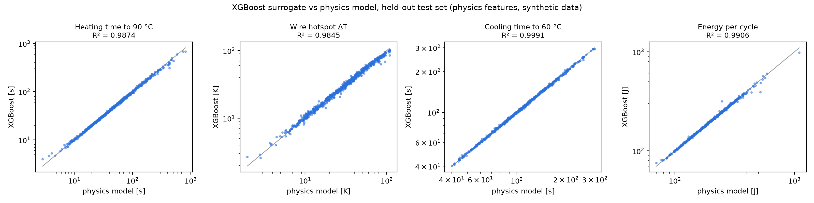
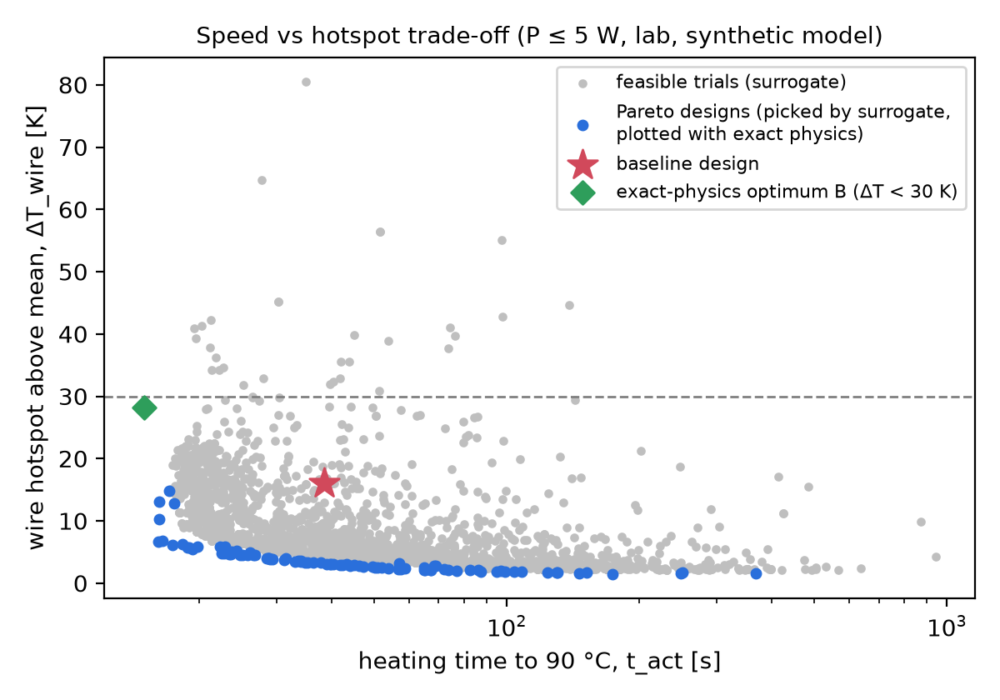

# smp-heater-surrogate

This project trains an ML model to predict how a shape-memory epoxy actuator heats up, and uses it to optimise the actuator's heater design. The heater is a zigzag nichrome wire. Because no lab or ANSYS data exists yet, the model is trained on **synthetic data generated from a physics model calibrated to published literature**.

It is the ML part of the B.Tech minor project *Design and Electrothermal Characterization of a Shape-Memory Epoxy Actuator with a Zigzag Nichrome Heater* (ARP-455, University School of Automation and Robotics, GGSIPU).

> **About the data:** every number in this repository comes from the lumped electrothermal model in the project report (equations 18–24, Table 5.5), not from measurements. The ML results show that a surrogate model can learn and optimise that physics model. They do not show that the physics model matches reality; that needs ANSYS or bench data, and the pipeline is built to be retrained on such data.

## Results at a glance

| Item | Result |
|---|---|
| Physics model | Reproduces every Stage-1 value in report Table 5.6 (20/20 tests pass) |
| Dataset | 5,000 Latin hypercube designs; 3,037 pass the validity checks |
| Surrogate (XGBoost, held-out test set) | Heating time R² 0.987, wire hotspot 0.985, cooling time 0.999, energy 0.991 |
| Physics-informed features | Raise heating-time R² from 0.77 (raw inputs only) to 0.99 |
| Optimised heater (P ≤ 5 W, hotspot < 30 K) | Heats to 90 °C in **16.1 s against 38.5 s** for the baseline, with a 6.6 K hotspot (baseline 16.0 K) and half the energy per cycle |

Details are in [results/README.md](results/README.md).

<p align="center">
  <br>
  
  
</p>

## Pipeline

| Step | Script | What it does |
|---|---|---|
| 1. Physics model | `src/physics.py` | Report eqs. (18)–(24): wire resistance and power, lumped heating and cooling, Biot and Fourier checks, wire hotspot, for lab (convection) and orbit (radiation) |
| 2. Dataset | `src/generate.py` | Latin hypercube over 7 design inputs → `data/synthetic_v1.csv`, with validity flags |
| 3. Surrogate | `src/train.py` | Feasibility classifier, plus Random Forest and XGBoost regressors on raw and physics-informed features; SHAP explanations |
| 4. Optimisation | `src/optimise.py` | Optuna TPE on the surrogate, checked against the exact physics; NSGA-II speed-versus-hotspot Pareto front |
| 5. Literature check | *planned* | Fit the recovery law (eq. 30) to curves digitised from the cited papers |

### Design inputs and ranges

| Input | Range |
|---|---|
| Wire diameter | 0.10–0.40 mm |
| Zigzag pitch | 2–6 mm |
| Zigzag width | 10–25 mm |
| Hinge width | 20–30 mm |
| Hinge thickness | 1–3 mm |
| Supply voltage | 3–12 V |
| Convection coefficient h | 5–15 W/m²K |

Hinge length is fixed at 30 mm.

## Quick start

```bash
python3 -m venv .venv
.venv/bin/pip install -r requirements.txt

.venv/bin/python -m pytest tests      # physics model must reproduce Table 5.6
.venv/bin/python src/generate.py      # ~3 s   -> data/synthetic_v1.csv
.venv/bin/python src/train.py         # ~8 min -> models/, figures/, results/metrics.csv
.venv/bin/python src/optimise.py      # ~2 min -> results/optimisation.csv, pareto_front.csv
```

The commands above were tested with Python 3.14 on a 4-core laptop CPU; no GPU is needed. Trained models are not committed (about 250 MB), so run `train.py` before `optimise.py`.

## Repository layout

```
src/        physics.py · generate.py · train.py · optimise.py
tests/      test_physics.py       regression test against report Table 5.6
data/       synthetic_v1.csv + README.md (data card: sources, ranges, flags, limitations)
results/    metrics.csv · optimisation.csv · pareto_front.csv · README.md (findings)
figures/    parity plots, SHAP beeswarm/bar plots, Pareto chart
PLAN.md     full project plan and remaining steps
```

## Known limitations

- **Physics model.** It uses lumped capacitance, constant nichrome resistivity, linear convection and a straight-wire conduction estimate for the hotspot. The surrogate inherits all of these assumptions.
- **Wire temperature limit.** The 200 °C wire-safe limit is an assumption. Replace it with the TGA/DSC limit of the actual resin (`T_WIRE_MAX_C` in `src/generate.py`).
- **Heater cut-off.** Optimised designs have steady-state temperatures of about 410–435 °C, so they need a thermostat or timed cut-off.
- **Thermal-only optimisation.** The optimum uses the thinnest hinge allowed (1.0 mm), which cuts stiffness and recovery torque to about 24 % of the baseline. Add a torque or stiffness constraint (report eqs. 27, 33) before using it for deployment.

## Next steps

1. Fit eq. (30) to recovery curves digitised from the cited papers (step 5).
2. Run a multi-fidelity upgrade: 2D finite-difference or ANSYS Transient Thermal runs to capture non-lumped hotspot effects.
3. Retrain the surrogate on measured bench data once tests begin.

## Authors

Karan Bhatt and Nizaam Khan, B.Tech Automation & Robotics, USAR, GGSIPU. Supervised by Prof. Pushp Kr Baghel.

All equations and parameter values are cited in the project report; key sources include Incropera et al. (heat transfer), Liu et al. 2006 (SMP constitutive model), Lan et al. 2009 (SMPC hinges) and Momeni & Ni 2020 (laws of 4D printing).
